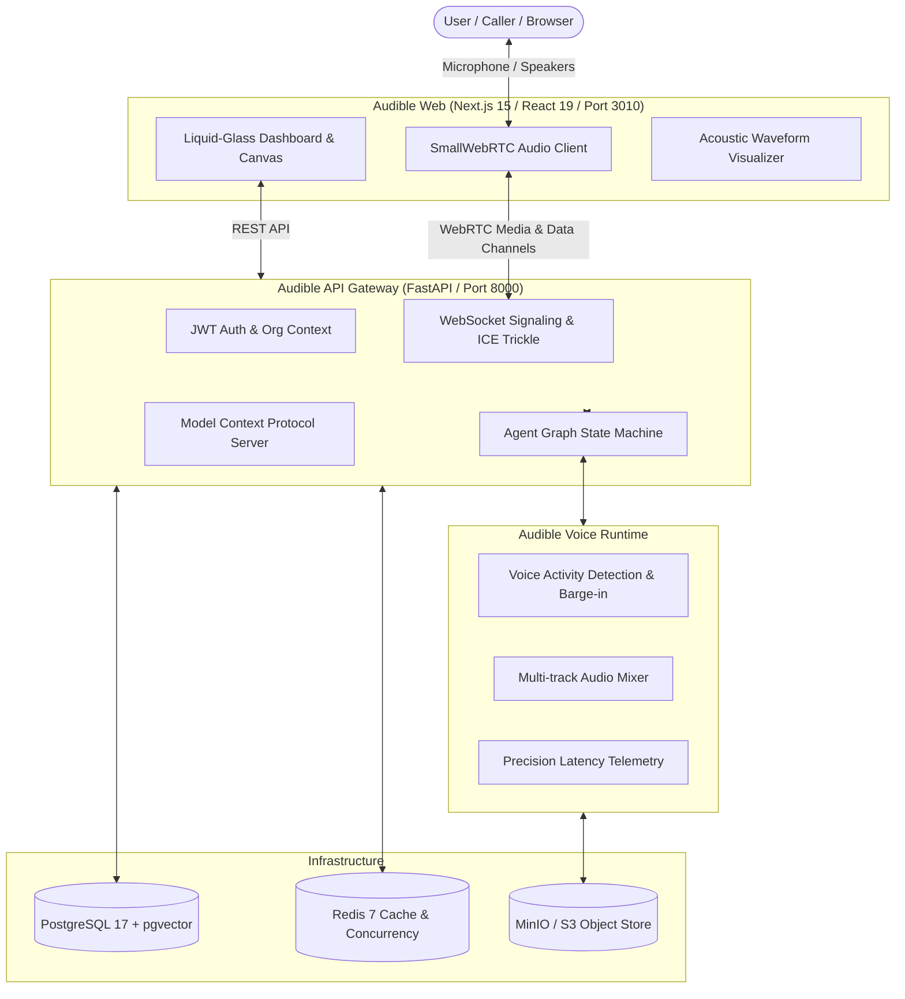

# AUDIBLE AI — Next-Generation Autonomous Voice Agent Operating System

<div align="center">


**Production-grade, sovereign conversational voice-agent platform with Apple-inspired liquid-glass design, sub-300ms barge-in latency, and native Model Context Protocol (MCP) tooling.**

[](LICENSE)
[](https://nextjs.org/)
[](https://fastapi.tiangolo.com/)
[](https://react.dev/)
[](https://www.python.org/)
[](https://tailwindcss.com/)
[](https://webrtc.org/)

[Features](#features) • [Architecture](#architecture) • [Quickstart](#quickstart) • [Voice Engine](#voice-engine) • [Docker Stack](#docker-deployment) • [License & Attribution](#license--attribution)

</div>

---

## Overview

**Audible** is an independently branded, modular, scalable AI voice-agent operating system. It enables developers and enterprise teams to construct, simulate, and orchestrate low-latency conversational agents with:

- **Apple-Inspired Liquid-Glass Interface**: VisionOS-grade translucent materials, subtle depth blurs, responsive acoustic visualizers, and polished dark/light themes.
- **Bi-directional Sub-300ms Barge-in**: Real-time Voice Activity Detection (VAD) coupled with immediate TTS playback cancellation for natural, human-like conversational interruptions.
- **Visual Workflow & State Graph Builder**: Drag-and-drop conversational nodes, conditional transitions, variable extractors, and live in-browser WebRTC playground testing.
- **Decoupled AI Engine Adapters**: First-class provider abstraction supporting:
  - **Speech-to-Text (STT)**: Deepgram (Nova-2/3), Cartesia, Whisper Large v3, Soniox, Speechmatics, Sarvam.
  - **Large Language Models (LLM)**: OpenAI (GPT-4o), Anthropic (Claude 3.5 Sonnet), Google Gemini (2.5 Flash), Groq (Llama 3.3 70B), Cerebras, Fireworks, OpenRouter.
  - **Text-to-Speech (TTS)**: Cartesia Sonic, ElevenLabs Flash, OpenAI TTS, Deepgram Aura, Minimax, Speechify, Smallest.
  - **Speech-to-Speech (S2S)**: OpenAI Realtime API, Gemini Multimodal Live, Ultravox.
- **Enterprise Telephony Bridge**: SIP Trunking, Twilio, Telnyx, Plivo, Vonage, Cloudonix, Exotel, and Asterisk (ARI) with cryptographic media token verification.
- **Native Model Context Protocol (MCP)**: FastMCP server allowing voice agents to execute real-time tools, call APIs, and read external knowledge bases safely.
- **Zero-Telemetry Privacy Default**: Fully self-hosted without unwanted remote tracking or proprietary telemetry beacons.

---

## Architecture



---

## Directory Structure

Audible is structured as a high-performance modular monorepo:

```text
audible-ai/
├── apps/
│   ├── web/                    # Audible Next.js 15 App Router Frontend (Port 3010)
│   └── api/                    # Audible FastAPI Core Engine (Port 8000)
├── packages/
│   ├── ui/                     # Liquid-glass design primitives, visualizers, components
│   ├── types/                  # Universal TypeScript and JSON schema contracts
│   └── sdk/                    # Client SDKs for TypeScript and Python
├── services/
│   ├── voice-runtime/          # Real-time streaming audio pipeline & barge-in coordinator
│   ├── speech-recognition/     # STT provider adapters (Deepgram, Whisper, Soniox, etc.)
│   ├── speech-synthesis/       # TTS provider adapters (Cartesia, ElevenLabs, OpenAI, etc.)
│   ├── agent-orchestrator/     # Conversational state machines & MCP execution bridge
│   ├── telephony/              # Carrier connectors (SIP, Twilio, Telnyx, Plivo, Asterisk)
│   └── integrations/           # FastMCP server, webhooks, and tool integrations
├── infrastructure/
│   ├── docker/                 # Production Docker Compose & Dockerfiles
│   └── deployment/             # Deployment configurations, templates, nginx rules
├── scripts/                    # Windows PowerShell & Bash operational orchestrators
├── docs/                       # Technical architecture, security, and setup guides
├── tests/                      # End-to-end integration test suites
├── LICENSE                     # BSD 2-Clause License
├── ATTRIBUTION.md              # Upstream attribution & legal provenance notice
└── README.md                   # Project overview & quickstart
```

---

## Quickstart

### Prerequisites
- **Node.js**: v20+ (tested on Node v24)
- **Python**: 3.12+ (tested on Python 3.14)
- **Docker Desktop** (optional for containerized deployment)
- **Windows 11 / Linux / macOS**

### Windows 11 Local Development

1. **Launch Services**:
   ```powershell
   # Starts Audible Web (port 3010) and Audible API (port 8000)
   .\scripts\start_audible_dev.ps1
   ```

2. **Access Audible**:
   - **Audible Web Dashboard**: [http://localhost:3010](http://localhost:3010)
   - **Audible API Health**: [http://localhost:8000/api/v1/health](http://localhost:8000/api/v1/health)
   - **Interactive API Documentation**: [http://localhost:8000/docs](http://localhost:8000/docs)

3. **Stop Services**:
   ```powershell
   .\scripts\stop_audible_dev.ps1
   ```

---

## Docker Deployment

To launch the full containerized stack (Postgres + Redis + MinIO + API + Web):

```bash
# Generate secure environment file
.\scripts\setup_local.ps1

# Start containerized stack
docker compose up -d
```

| Service | Container Name | Port | Description |
|---|---|---|---|
| **Audible Web** | `audible-ui` | `3010` | Next.js 15 Liquid-Glass UI |
| **Audible API** | `audible-api` | `8000` | FastAPI REST & WebRTC Gateway |
| **PostgreSQL** | `postgres` | `5432` | Postgres 17 with `pgvector` extension |
| **Redis** | `redis` | `6379` | High-speed cache & distributed task queue |
| **MinIO** | `minio` | `9000` / `9001` | S3-compatible call audio & transcript store |

---

## Voice Engine & Latency Optimization

Audible features sub-second voice turnaround through pipelined audio chunk streaming:

1. **Direct Audio Sampling**: 16kHz/24kHz linear PCM streaming over SmallWebRTC data channels.
2. **Dynamic VAD**: Energy-based and neural Silero VAD frame analysis with configurable speech start thresholds (default 90ms) and stop thresholds (default 400ms).
3. **Speculative Barge-in**: User speech immediately clears the server-side TTS audio queue and triggers client playback halt.
4. **Precision Latency Telemetry**: Turn-by-turn tracking of Time to First Token (TTFT) and Time to First Byte (TTFB).

---

## License & Attribution

Audible AI is distributed under the **BSD 2-Clause License**. See [LICENSE](LICENSE) for details.

This project incorporates and builds upon software originally developed under the Dograh project (Copyright (c) 2025, Zansat Technologies Private Limited). For full provenance, upstream references, and attribution details, see [ATTRIBUTION.md](ATTRIBUTION.md).
